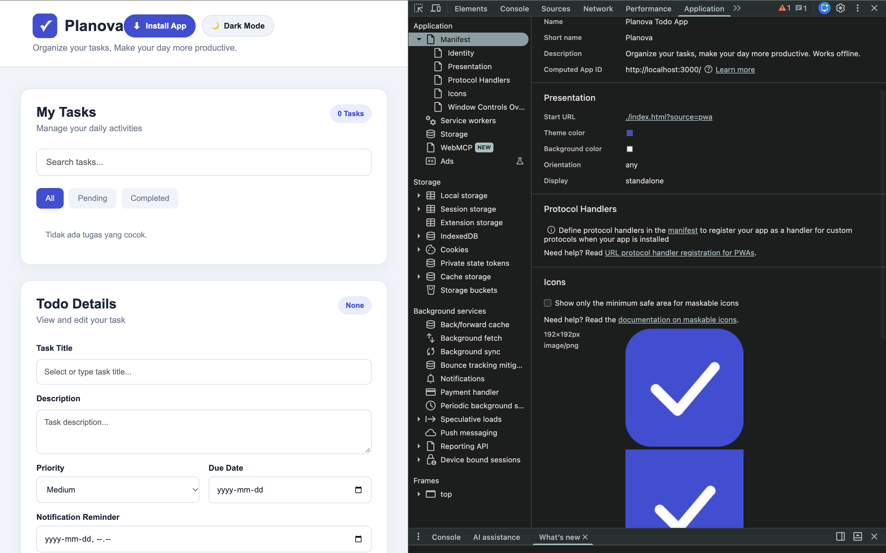
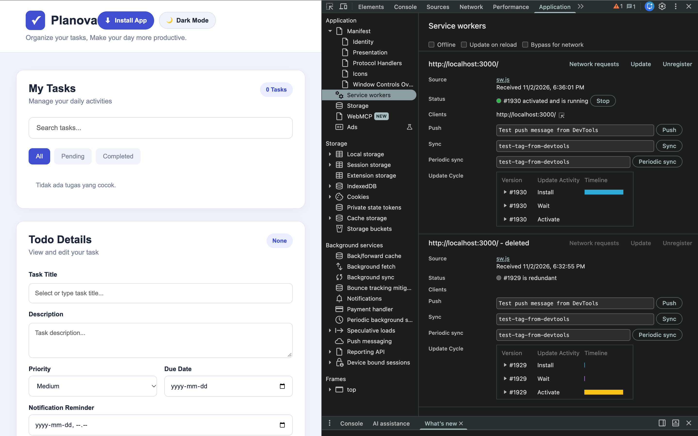
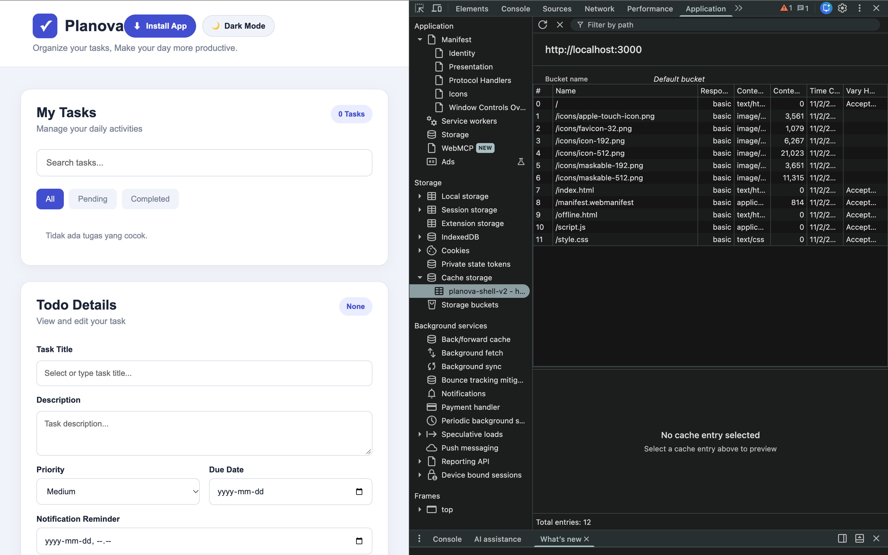
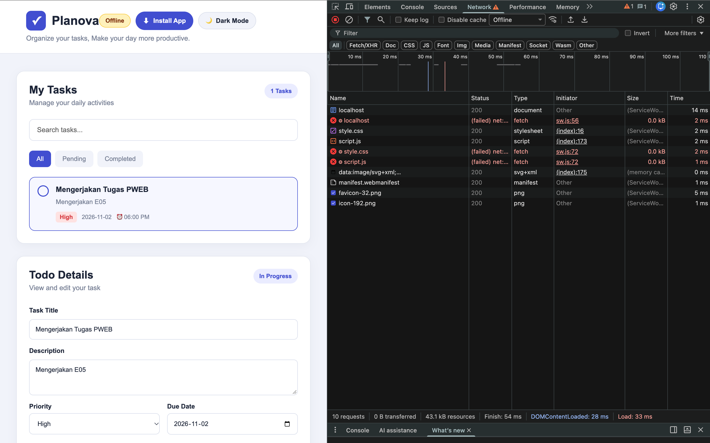
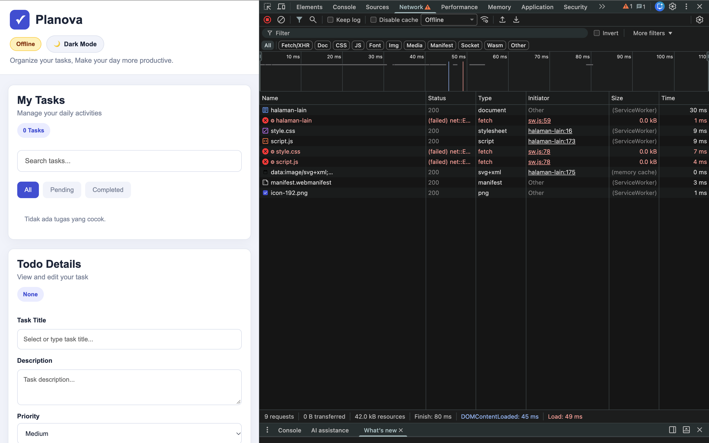
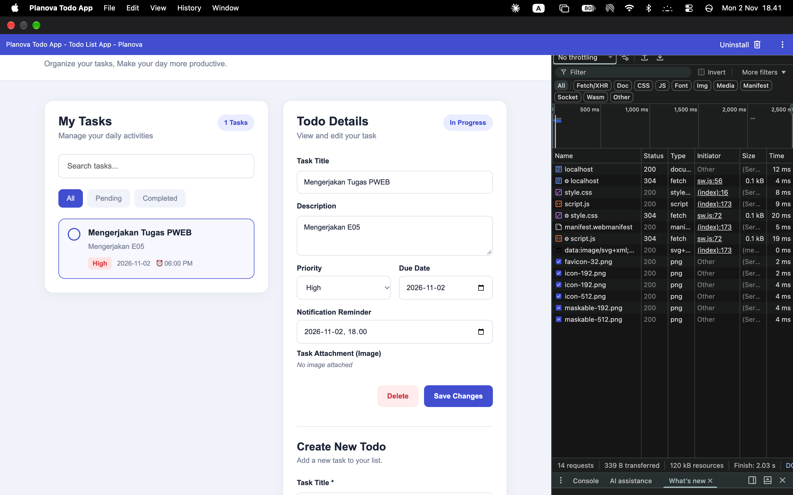

# Planova Todo App

Nama: Rafi Eka Pramudya

NRP: 5025251200

Kelas: Pemrograman Web (A)

Link: https://if-pemrograman-web-a.github.io/5025251200_Todo-App/

## Tentang aplikasi

Planova adalah aplikasi todo list yang dibuat untuk tugas mata kuliah Pemrograman Web. Aplikasinya dijadikan PWA (Progressive Web App) supaya tetap bisa dibuka tanpa internet dan bisa di-install seperti aplikasi biasa.

Fitur yang sudah ada dari tugas sebelumnya:
- tambah, edit, hapus, dan centang tugas
- cari tugas dan filter All / Pending / Completed
- prioritas, tanggal, dan pengingat notifikasi
- ambil foto dari kamera atau upload gambar
- mode terang dan gelap
- data disimpan di IndexedDB, tema disimpan di localStorage

## Struktur file

```
index.html            halaman utama
style.css             tampilan
script.js             logika aplikasi + tombol install
sw.js                 service worker
manifest.webmanifest  manifest PWA
offline.html          halaman cadangan saat offline
icons/                ikon aplikasi
docs/screenshots/     bukti pengujian
```

## E05

### Manifest
`manifest.webmanifest` dipasang di `index.html` lewat tag `<link rel="manifest">`. Isinya nama aplikasi, `display standalone`, warna tema `#5267d9`, dan ikon 192x192 serta 512x512 (termasuk versi maskable). Semua path dibuat relatif supaya tetap jalan di GitHub Pages yang memakai sub-path.

### Precache
Saat service worker di-install, file berikut langsung disimpan ke cache `planova-shell-v2` (`index.html`, `offline.html`, `style.css`, `script.js`, manifest, dan semua ikon). Cache versi lama dihapus saat service worker aktif.

### Strategi caching

| Resource | Strategi | Kenapa |
|---|---|---|
| Halaman HTML | Network First, kalau gagal ambil dari cache, terakhir `offline.html` | biar dapat versi terbaru kalau online |
| CSS dan JS | Stale While Revalidate | cepat dari cache, update jalan di belakang |
| Gambar, ikon, manifest | Cache First | jarang berubah |
| Request ke domain lain | tidak di-cache | |

Pakai service worker biasa, tidak pakai Workbox.

### Tombol install
Tombol "Install App" ada di header dan awalnya disembunyikan. Tombol baru muncul kalau browser mengirim event `beforeinstallprompt`. Setelah diklik, muncul dialog install bawaan browser. Saat koneksi putus juga muncul label "Offline" di header.

## Cara menjalankan

```bash
npx serve .
```

buka ```http://localhost:3000``` di Chrome. Service worker dan kamera hanya jalan di localhost atau HTTPS. Kalau sebelumnya pernah buka versi lama, buka DevTools, Application, Storage, lalu klik Clear site data.

## Pengujian offline

Langkah yang dilakukan:
1. Buka aplikasi lewat `localhost:3000` saat online.
2. Buka DevTools, tab Application. Cek Manifest, Service Workers, dan Cache Storage.
3. Ubah Network jadi Offline (DevTools harus tetap terbuka), lalu refresh.
4. Tambah, ubah, dan hapus tugas saat offline, lalu refresh lagi.
5. Buka alamat yang tidak ada (`/halaman-lain`) dan `/offline.html`.
6. Matikan mode Offline, lalu coba tombol Install App.

Screenshot:

Manifest


Service worker aktif


Cache storage


Aplikasi saat offline


Halaman offline.html


Install

